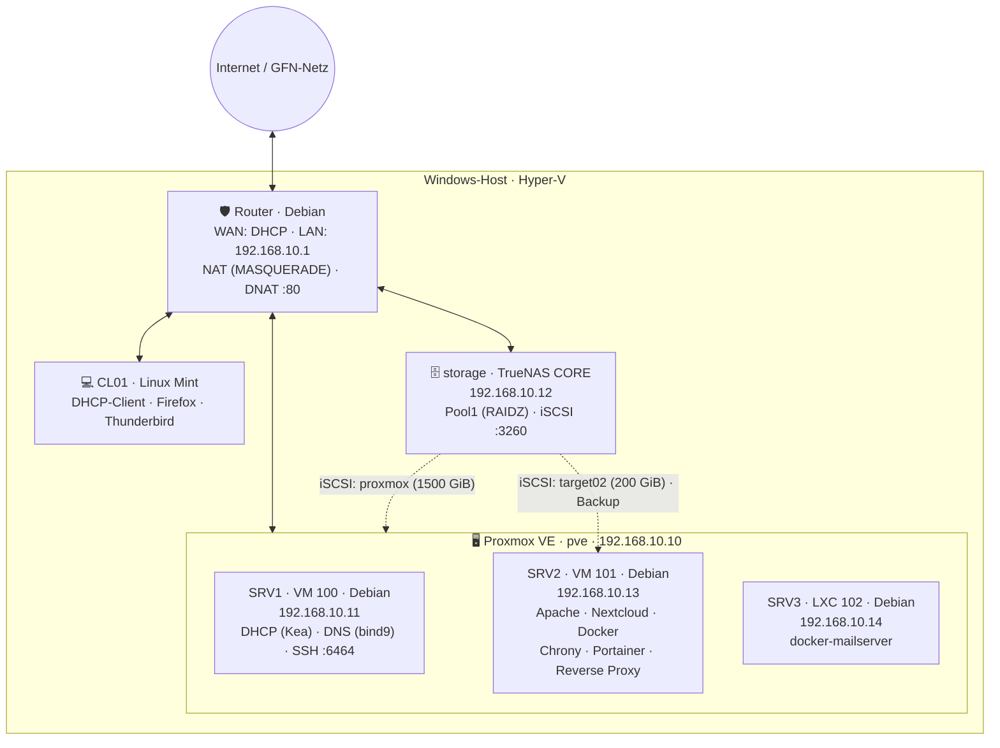
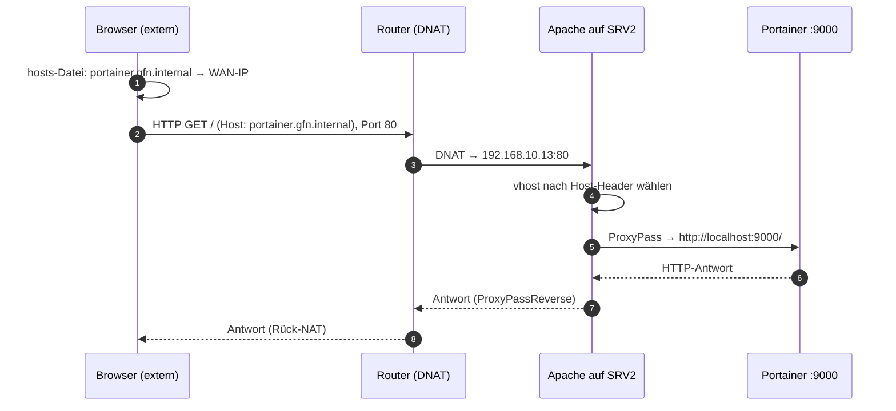
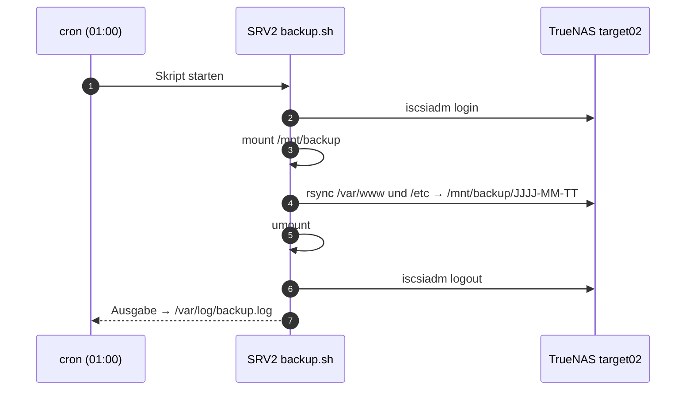
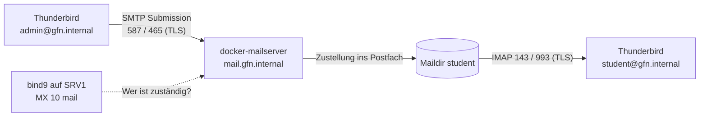
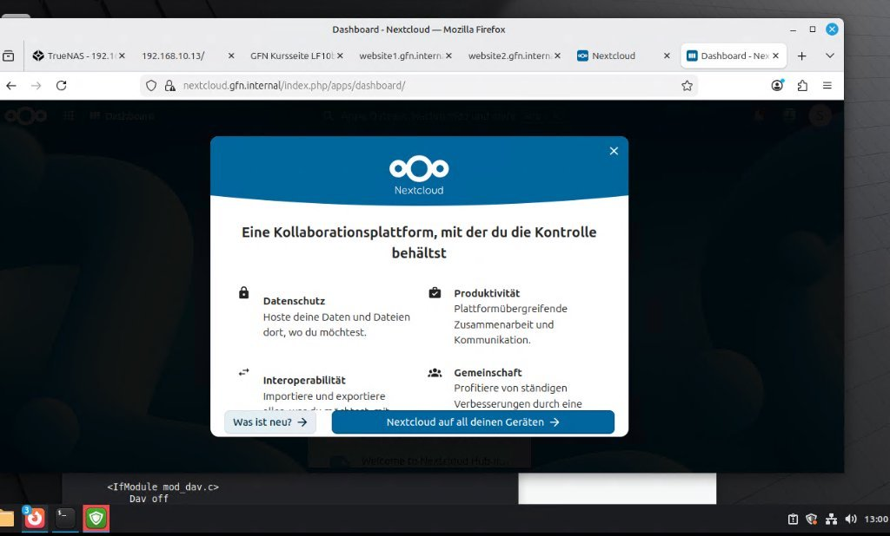
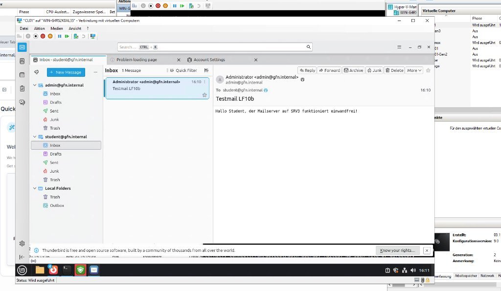

# LF10b – Serverdienste bereitstellen und Administrationsaufgaben automatisieren


Dieses Repository dokumentiert ein **komplettes Server-Lab**, das ich im Lernfeld 10b meiner Umschulung zur
**Fachinformatikerin für Systemintegration** (GFN, November 2026) Schritt für Schritt aufgebaut habe.

Das Lab bildet ein kleines Firmennetz nach. Es enthält einen Router mit NAT, einen Hypervisor, Storage über iSCSI, interne Dienste
(DHCP, DNS, NTP), Webserver mit Virtual Hosts, Nextcloud mit HTTPS, Docker-Container, einen Reverse Proxy mit Port-Forwarding
und einen eigenen Mailserver. Ein automatisiertes Backup ist ebenfalls dabei.

> **Hinweis:** Lab-Umgebung zu Lernzwecken. Alle IP-Adressen sind privat (RFC 1918), Zertifikate sind selbstsigniert.
> Passwörter wurden aus allen Dateien entfernt und durch Platzhalter wie `<PASSWORT>` ersetzt.
>
> **Quelle:** Die Aufgabenstellungen stammen aus dem GFN-Kurs LF10b. Aufbau, Konfiguration und Dokumentation sind meine eigene Arbeit.

---

## Inhalt

1. [Netzwerkarchitektur](#1-netzwerkarchitektur)
2. [Systeme und Adressen](#2-systeme-und-adressen)
3. [Dienste und Ports](#3-dienste-und-ports)
4. [Umsetzung nach Themen](#4-umsetzung-nach-themen)
5. [Datenflüsse](#5-datenflüsse)
6. [Aufgabenübersicht](#6-aufgabenübersicht)
7. [Prüfungswissen IHK AP1/AP2](#7-prüfungswissen-ihk-ap1ap2)
8. [Repository-Struktur](#8-repository-struktur)
9. [Proof of Work](#9-proof-of-work)

---

## 1. Netzwerkarchitektur

Das Lab läuft auf einem Windows-Host mit **Hyper-V**. Im internen vSwitch „Firmennetz“ (192.168.10.0/24) liegen
der Router, der Client und der Hypervisor **Proxmox VE**. Proxmox betreibt dann die eigentlichen Server.



**Netz:** `192.168.10.0/24` · **Gateway:** `192.168.10.1` · **Domain:** `gfn.internal` · **DHCP-Pool:** `.100 – .200`

---

## 2. Systeme und Adressen

| System | Plattform | IP-Adresse | FQDN | Rolle |
|---|---|---|---|---|
| Router | Debian (Hyper-V VM) | LAN `192.168.10.1` · WAN per DHCP | `router.gfn.internal` | Gateway, SNAT/Masquerading, DNAT |
| Proxmox | Proxmox VE 9.2 (Hyper-V VM) | `192.168.10.10` | `proxmox.gfn.internal` | Hypervisor (KVM + LXC), iSCSI-Initiator |
| SRV1 | Debian (VM 100) | `192.168.10.11` | `srv1.gfn.internal` | SSH, DHCP, DNS, interne Dienste |
| storage | TrueNAS CORE 13.0 (Hyper-V VM) | `192.168.10.12` | `storage.gfn.internal` | ZFS-Pool, iSCSI-Targets |
| SRV2 | Debian 13 (VM 101) | `192.168.10.13` | `srv2.gfn.internal` | Webserver, Docker-Host, Backup |
| SRV3 | Debian 12 (LXC 102) | `192.168.10.14` | `srv3` / `mail.gfn.internal` | E-Mail-Server |
| CL01 | Linux Mint | DHCP (`.100 – .200`) | `cl01` | Test-Client |

---

## 3. Dienste und Ports

| Port | Protokoll | Dienst | System | Zweck |
|---|---|---|---|---|
| 22 / **6464** | TCP | OpenSSH | SRV1 (6464), SRV2, SRV3 | Fernwartung, Public-Key-Auth |
| 53 | UDP/TCP | bind9 | SRV1 | DNS (Forward- und Reverse-Zone) |
| 67 / 68 | UDP | Kea DHCPv4 | SRV1 | IP-Konfiguration für Clients |
| 80 | TCP | Apache 2 | SRV2 | HTTP, vhosts, Reverse Proxy |
| 443 | TCP | Apache 2 + mod_ssl | SRV2 | HTTPS (Nextcloud) |
| 123 | UDP | Chrony (Docker) | SRV2 | NTP-Zeitserver |
| 3260 | TCP | iSCSI | storage | Block-Storage für Proxmox und SRV2 |
| 3306 | TCP | MariaDB | SRV2 (localhost) | Datenbank für Nextcloud |
| 8006 | TCP | Proxmox Web-GUI | Proxmox | Verwaltung der VMs/Container |
| 9000 / 9443 | TCP | Portainer CE | SRV2 | Docker-Verwaltung (HTTP/HTTPS) |
| 25 | TCP | SMTP | SRV3 | Mailtransport zwischen Servern |
| 465 / 587 | TCP | SMTPS / Submission | SRV3 | Mailversand vom Client (TLS / STARTTLS) |
| 143 / 993 | TCP | IMAP / IMAPS | SRV3 | Postfach abrufen (STARTTLS / TLS) |

---

## 4. Umsetzung nach Themen

### 4.1 Router – NAT und IP-Forwarding (Aufgabe 12)

Der Router hat zwei Netzwerkkarten: `eth0` (WAN, DHCP) und `eth1` (LAN, statisch).
Pakete aus dem Firmennetz werden per **Masquerading (SNAT)** ins Internet weitergeleitet.

```bash
# /etc/sysctl.d/99-ip-forward.conf  -> dauerhaft, übersteht einen Reboot
net.ipv4.ip_forward=1

# NAT für ausgehenden Verkehr
iptables -t nat -A POSTROUTING -o eth0 -j MASQUERADE
apt install iptables-persistent -y        # Regeln dauerhaft speichern
```

➡️ [`configs/router/`](configs/router/)

### 4.2 SRV1 – DHCP mit Kea (Aufgabe 17, 36)

```json
"subnet4": [{
  "id": 1,
  "subnet": "192.168.10.0/24",
  "pools": [ { "pool": "192.168.10.100 - 192.168.10.200" } ],
  "option-data": [
    { "name": "routers",             "data": "192.168.10.1"  },
    { "name": "domain-name-servers", "data": "192.168.10.11" },
    { "name": "domain-name",         "data": "gfn.internal"  },
    { "name": "ntp-servers",         "data": "192.168.10.13" }
  ]
}]
```

Die Option `ntp-servers` (DHCP-Option 42) wurde in Aufgabe 36 ergänzt. So bekommen alle Clients automatisch den Zeitserver.
➡️ [`configs/srv1/kea-dhcp4.conf`](configs/srv1/kea-dhcp4.conf)

### 4.3 SRV1 – DNS mit bind9 (Aufgabe 18, 27, 30–32, 39, 42)

SRV1 ist der autoritative DNS-Server für `gfn.internal`. Externe Anfragen gehen an `1.1.1.1` / `8.8.8.8` (Forwarder).

```dns
$TTL 2D
@         IN  SOA   srv1.gfn.internal. administrator.gfn.internal. ( 1 8H 2H 4W 3H )
@         IN  NS    srv1.gfn.internal.
@         IN  MX 10 mail
mail      IN  A     192.168.10.14
srv2      IN  A     192.168.10.13
lf10b     IN  A     192.168.10.13
nextcloud IN  CNAME srv2
portainer IN  CNAME srv2
```

➡️ [`configs/srv1/bind/`](configs/srv1/bind/) · Test: `dig proxmox.gfn.internal @192.168.10.11`

### 4.4 SSH-Härtung (Aufgabe 16, 19–21)

- Anmeldung per **Public-Key-Authentifizierung** (Schlüsselpaar auf CL01, öffentlicher Schlüssel auf dem Server)
- SSH-Port auf SRV1 von **22 → 6464** verlegt (weniger automatische Scans, **ersetzt aber keine Updates**)
- `~/.ssh/config` auf dem Client: kurze Anmeldung mit `ssh srv1`

➡️ [`configs/srv1/sshd_config.snippet`](configs/srv1/sshd_config.snippet) · [`configs/client/ssh_config`](configs/client/ssh_config)

### 4.5 Storage – TrueNAS, ZFS und iSCSI (Aufgabe 22–25)

| Schritt | Ergebnis |
|---|---|
| Speicherpool | `Pool1`, **RAIDZ** aus 3 × 1 TiB, Kompression `lz4`, ca. 1,93 TiB nutzbar |
| iSCSI-Target 1 | `iqn.2005-10.org.freenas.ctl:proxmox` · Zvol 1500 GiB · Blockgröße 4k · Portal `0.0.0.0:3260` |
| Anbindung Proxmox | Storage `iscsi-storage` (Rechenzentrum → Storage → Hinzufügen → iSCSI) |
| iSCSI-Target 2 | `iqn.2005-10.org.freenas.ctl:target02` · 200 GiB · nur für SRV2 (Backup) |

```bash
# SRV2 als iSCSI-Initiator
apt install open-iscsi -y
iscsiadm -m discovery -t sendtargets -p 192.168.10.12
iscsiadm -m node -T iqn.2005-10.org.freenas.ctl:target02 -p 192.168.10.12 -l   # login
lsblk                                                                          # neues Gerät: sdb
```

### 4.6 Backup – automatisiert mit rsync und cron (Aufgabe 26, 28)

Das Backup-Target ist **nur während des Backups eingebunden**. Ein Angreifer oder eine Ransomware auf SRV2 kann das Backup also im Normalbetrieb nicht sehen.

```bash
# /usr/local/bin/backup.sh  (Kurzfassung)
iscsiadm -m node -T $ISCSI_TARGET -p $ISCSI_IP -l     # 1. Target anmelden
mount /dev/disk/by-path/...-lun-0-part1 /mnt/backup   # 2. Partition mounten
rsync -a /var/www /etc /mnt/backup/$(date +%F)/       # 3. Daten sichern
umount /mnt/backup                                    # 4. aushängen
iscsiadm -m node -T $ISCSI_TARGET -p $ISCSI_IP -u     # 5. Target abmelden
```

```cron
0 1 * * * /usr/local/bin/backup.sh >> /var/log/backup.log 2>&1
```

Theorie dazu: [Desaster Recovery Plan nach BSI-Standard 200-4](docs/desaster-recovery-plan.md)
➡️ [`configs/srv2/backup/`](configs/srv2/backup/)

### 4.7 Webserver – Apache mit Virtual Hosts (Aufgabe 29–31)

Ein Apache auf **einer** IP-Adresse liefert mehrere Websites aus (**namensbasierte vhosts**).
Der Browser schickt den FQDN im HTTP-Header `Host:` mit, und Apache wählt danach den passenden vhost.

```apache
<VirtualHost *:80>
    ServerName lf10b.gfn.internal
    DocumentRoot /var/www/lf10b/
    ErrorLog /var/log/apache2/lf10b-error.log
    CustomLog /var/log/apache2/lf10b-access.log combined
</VirtualHost>
```

```bash
sudo a2ensite lf10b.gfn.internal.conf && sudo systemctl reload apache2
```

vhosts: `lf10b.gfn.internal`, `website1.gfn.internal`, `website2.gfn.internal` ➡️ [`configs/srv2/apache/`](configs/srv2/apache/)

### 4.8 Nextcloud mit HTTPS (Aufgabe 32, 34)

Stack: **Apache + PHP (inkl. OPcache, APCu) + MariaDB**.

```bash
# Selbstsigniertes Zertifikat (365 Tage, RSA 2048)
sudo a2enmod ssl
sudo openssl req -x509 -nodes -days 365 -newkey rsa:2048 \
  -keyout /etc/ssl/private/apache-selfsigned.key \
  -out /etc/ssl/certs/apache-selfsigned.crt
```

```apache
<VirtualHost *:80>
    ServerName nextcloud.gfn.internal
    Redirect "/" https://nextcloud.gfn.internal/      # HTTP -> HTTPS
</VirtualHost>

<VirtualHost *:443>
    ServerName nextcloud.gfn.internal
    DocumentRoot /var/www/nextcloud
    SSLEngine on
    SSLCertificateFile    /etc/ssl/certs/apache-selfsigned.crt
    SSLCertificateKeyFile /etc/ssl/private/apache-selfsigned.key
</VirtualHost>
```

➡️ [`nextcloud.gfn.internal.conf`](configs/srv2/apache/nextcloud.gfn.internal.conf) · [`php.ini.snippet`](configs/srv2/php.ini.snippet) · [`nextcloud-db.sql`](configs/srv2/nextcloud-db.sql)

### 4.9 Docker – Chrony und Portainer (Aufgabe 35–38)

Docker CE wurde aus dem **offiziellen Docker-Repository** installiert (nicht aus dem Debian-Repo). Der Benutzer `student` ist in der Gruppe `docker`.

```yaml
# ~/docker/chrony/docker-compose.yml – NTP-Server
services:
  ntp:
    image: cturra/ntp:latest
    container_name: chrony
    restart: always
    ports:
      - 123:123/udp
    environment:
      - NTP_SERVERS=time.cloudflare.com
      - TZ=Europe/Berlin
```

```yaml
# ~/docker/portainer/docker-compose.yml – Web-GUI für Docker
services:
  portainer:
    image: portainer/portainer-ce:latest
    restart: unless-stopped
    security_opt:
      - no-new-privileges:true
    volumes:
      - /var/run/docker.sock:/var/run/docker.sock:ro
      - ./portainer-data:/data
    ports:
      - 9000:9000
      - 9443:9443
```

Test des Zeitservers vom Client: `ntpdate -q 192.168.10.13` ➡️ [`configs/srv2/docker/`](configs/srv2/docker/)

### 4.10 Reverse Proxy und Port-Forwarding (Aufgabe 39, 40)

Portainer ist ohne Portnummer unter `http://portainer.gfn.internal` erreichbar, auch **von außerhalb** des Firmennetzes.

```apache
<VirtualHost *:80>
    ServerName portainer.gfn.internal
    ProxyPreserveHost On
    ProxyPass        / http://localhost:9000/
    ProxyPassReverse / http://localhost:9000/
</VirtualHost>
```

```bash
# SRV2
sudo a2enmod proxy proxy_http && sudo a2ensite portainer.gfn.internal.conf
# Router: Port 80 auf der WAN-Seite -> SRV2
iptables -t nat -A PREROUTING -p tcp -d <WAN-IP> --dport 80 -j DNAT --to-destination 192.168.10.13:80
iptables-save > /etc/iptables/rules.v4
```

Auf dem externen Windows-Rechner wurde die Namensauflösung über `C:\Windows\System32\drivers\etc\hosts` eingetragen.

### 4.11 Mailserver und Mailclient (Aufgabe 42, 43)

- **SRV3** als **LXC-Container** auf Proxmox (Debian-12-Template, 2 Kerne, 1 GiB RAM, 50 GiB)
- **docker-mailserver** (Postfix + Dovecot + Rspamd + ClamAV), TLS mit eigenem Zertifikat (`SSL_TYPE=manual`)
- DNS: **MX-Record** `@ IN MX 10 mail` und **A-Record** `mail → 192.168.10.14`
- Postfächer `admin@gfn.internal` und `student@gfn.internal`
- **Thunderbird** auf CL01: Zertifikat bestätigt, Testmail von admin an student versendet und empfangen ✅

➡️ [`configs/srv3/mailserver/`](configs/srv3/mailserver/)

---

## 5. Datenflüsse

### Aufruf einer Website über den Reverse Proxy (von extern)



### Automatisches Backup



### E-Mail von admin an student



---

## 6. Aufgabenübersicht

| Nr. | Aufgabe | Technik | Status |
|---|---|---|:---:|
| 10–11 | Basisinformationen, Grundkonfiguration des Labs | Hyper-V, vSwitch | ✅ |
| 12 | Installation Router | Debian, iptables, NAT | ✅ |
| 13 | Installation Client CL01 | Linux Mint | ✅ |
| 14 | Installation Hypervisor | Proxmox VE | ✅ |
| 15–16 | Installation SRV1, SSH-Verbindung | Debian, OpenSSH | ✅ |
| 17 | DHCP-Server | Kea DHCPv4 | ✅ |
| 18 | DNS-Server | bind9 | ✅ |
| 19–21 | SSH Public Key, Port 6464, Client-Config | OpenSSH | ✅ |
| 22–23 | Storage Server, Speicherpool | TrueNAS CORE, ZFS RAIDZ | ✅ |
| 24–25 | iSCSI-Target bereitstellen und anbinden | iSCSI, Proxmox | ✅ |
| 26 | Desaster Recovery Plan | BSI-Standard 200-4 | ✅ |
| 27 | Installation SRV2 | Proxmox VM, Debian | ✅ |
| 28 | Backup einrichten und automatisieren | open-iscsi, rsync, cron | ✅ |
| 29–31 | Apache, vhosts, Vertiefung | Apache 2 | ✅ |
| 32 | Nextcloud | Apache, PHP, MariaDB | ✅ |
| 34 | Absicherung mit Verschlüsselung | OpenSSL, mod_ssl, HTTPS | ✅ |
| 35 | Docker | Docker CE, Compose-Plugin | ✅ |
| 36–37 | Chrony per docker / docker compose | NTP, Docker Compose | ✅ |
| 38 | Portainer | Portainer CE | ✅ |
| 39 | Reverse Proxy | Apache mod_proxy | ✅ |
| 40 | Port-Forwarding | iptables DNAT | ✅ |
| 42 | Mailserver | LXC, docker-mailserver | ✅ |
| 43 | Mailclient | Thunderbird | ✅ |

---

## 7. Prüfungswissen IHK AP1/AP2

Die wichtigsten Begriffe aus diesem Lab, kurz erklärt: **[docs/ihk-pruefungswissen.md](docs/ihk-pruefungswissen.md)**

Themen: NAT/SNAT/DNAT, DHCP-Ablauf (DORA), DNS-Records, iSCSI-Begriffe, RAID/RAIDZ, Backup-Strategien (3-2-1, RTO/RPO),
VM vs. Container, Reverse Proxy, TLS/Zertifikate, Mail-Protokolle und Ports.

---

## 8. Repository-Struktur

```text
.
├── README.md
├── configs/
│   ├── router/        interfaces · sysctl (IP-Forwarding) · iptables (NAT/DNAT)
│   ├── srv1/          kea-dhcp4.conf · bind/ (Optionen, Zonen) · sshd_config
│   ├── srv2/          interfaces · apache/ (vhosts) · backup/ · docker/ · php.ini · SQL
│   ├── srv3/          mailserver/ (docker-compose, env, Setup)
│   └── client/        ssh_config
└── docs/
    ├── ihk-pruefungswissen.md
    ├── desaster-recovery-plan.md
    ├── proof-of-work.md
    └── images/        Screenshots aus dem Lab
```

---

## 9. Proof of Work

Screenshots aus dem laufenden Lab, z. B. TrueNAS, Proxmox, Nextcloud, Portainer und Thunderbird:
**[docs/proof-of-work.md](docs/proof-of-work.md)**

<p align="center">
  
  
</p>

---

**Autorin:** Güler Zengin Kisaoğlu · Umschulung Fachinformatikerin für Systemintegration (GFN)
