# Proof of Work – Screenshots aus dem Lab

Diese Screenshots zeigen das laufende Lab (Hyper-V auf einem GFN-Schulungsrechner, Zugriff über den Client CL01).

[← zurück zur README](../README.md)

---

## Storage (TrueNAS CORE)

| TrueNAS Dashboard | Pool1 (RAIDZ, lz4) |
|---|---|
| 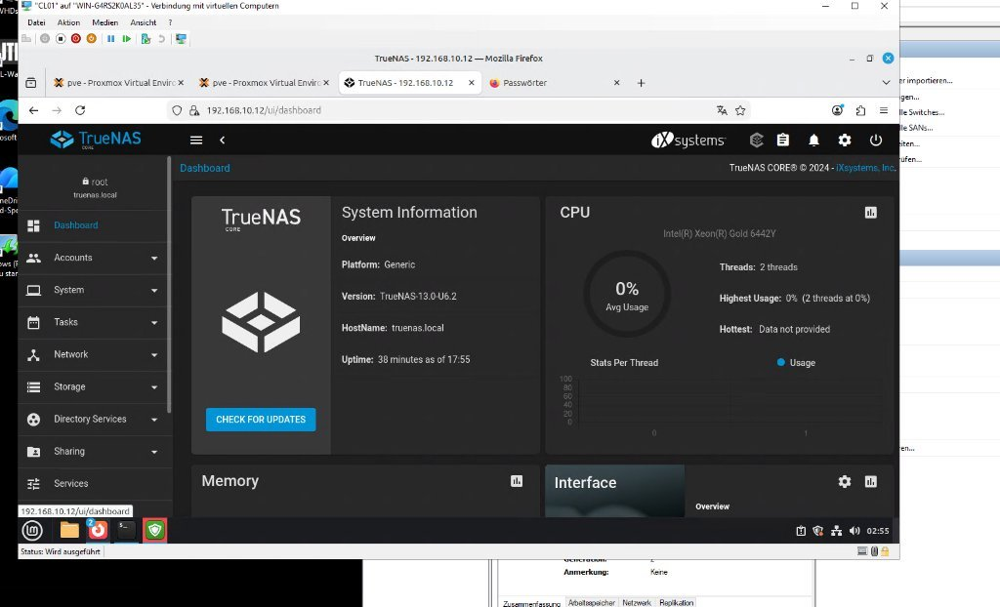 | 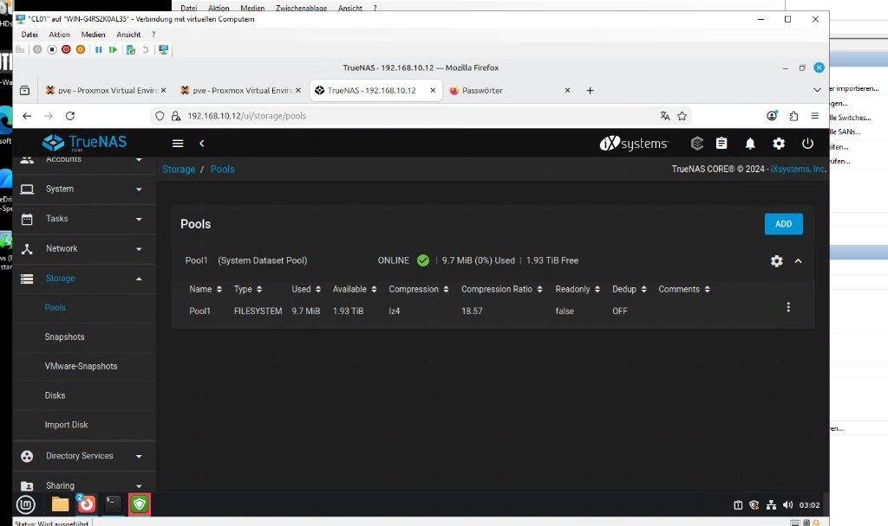 |

| iSCSI-Wizard (target02) | Proxmox: iSCSI-Storage anbinden |
|---|---|
| 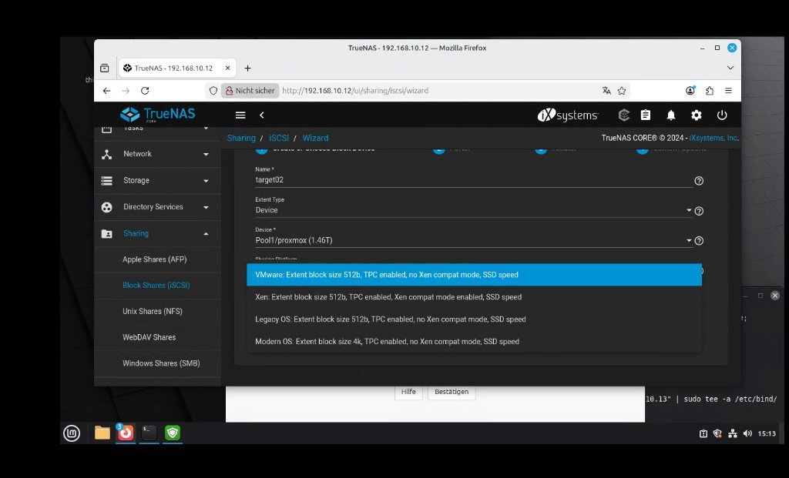 | 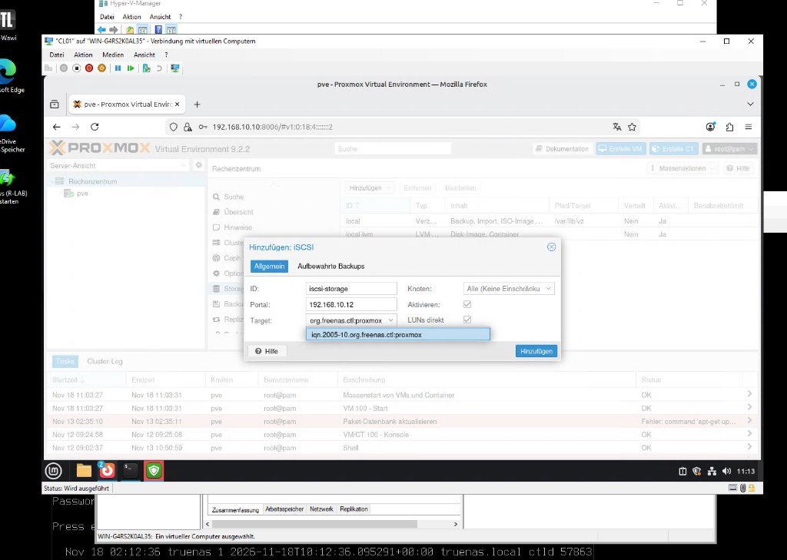 |

**SRV2 als iSCSI-Initiator:** Discovery zeigt beide Targets, nach dem Login erscheint `sdb` (200 G).

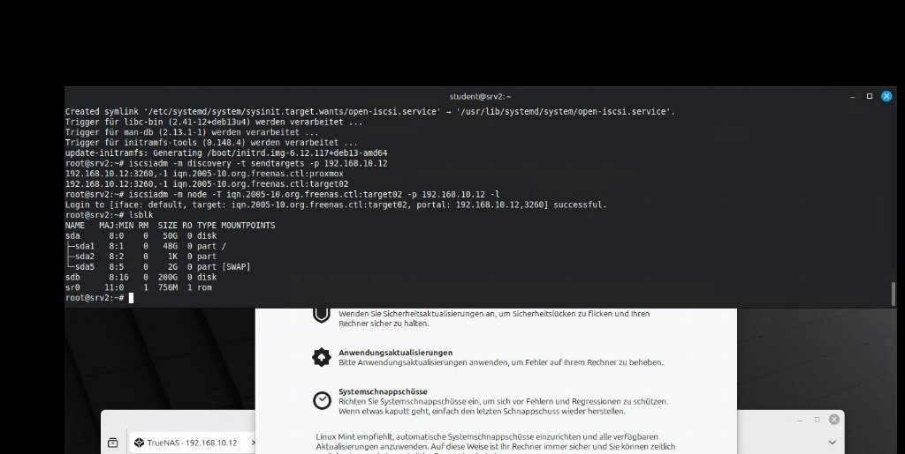

## Webserver (Apache, vhosts)

| vhost-Konfiguration | lf10b.gfn.internal |
|---|---|
| 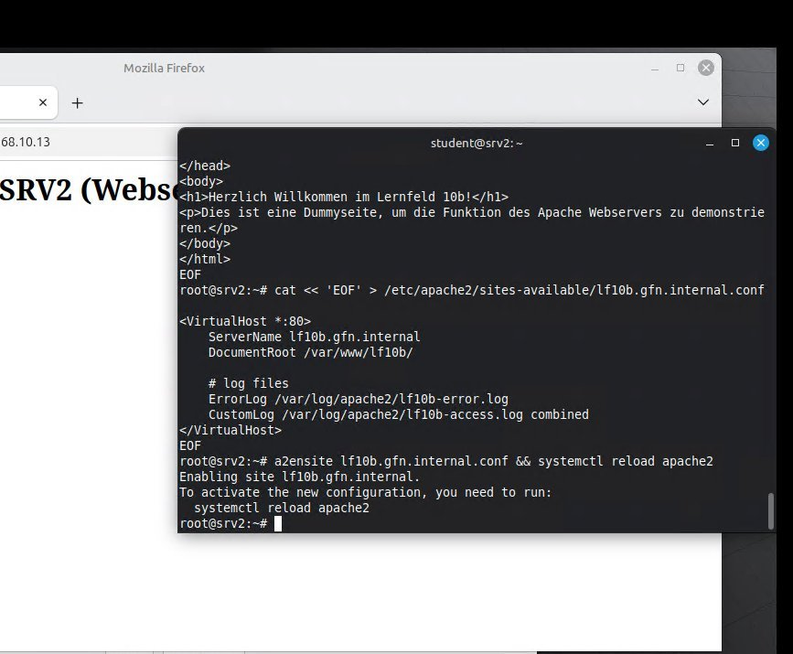 | 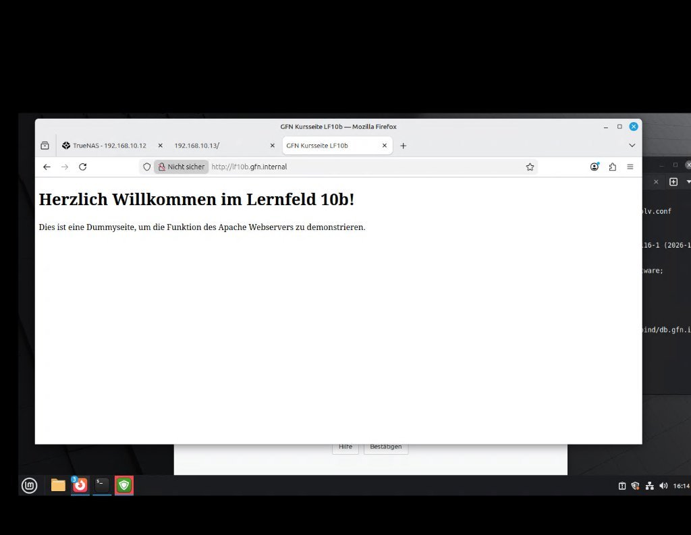 |

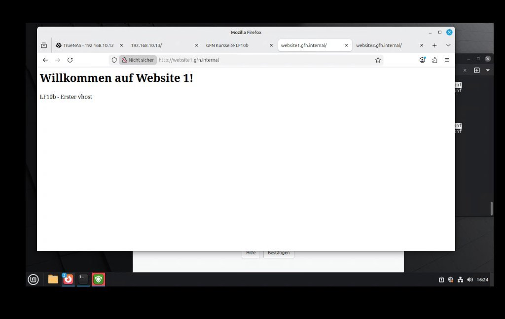

## Nextcloud (HTTPS)

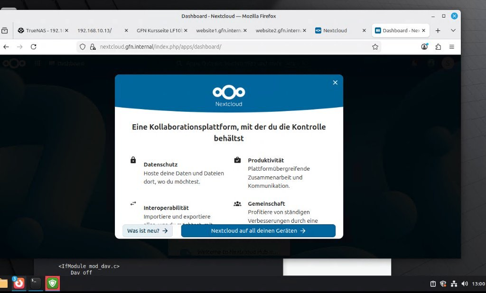

## Docker: Chrony und Portainer

**NTP-Abfrage** auf den Chrony-Container: `ntpdate` antwortet von `192.168.10.13`.

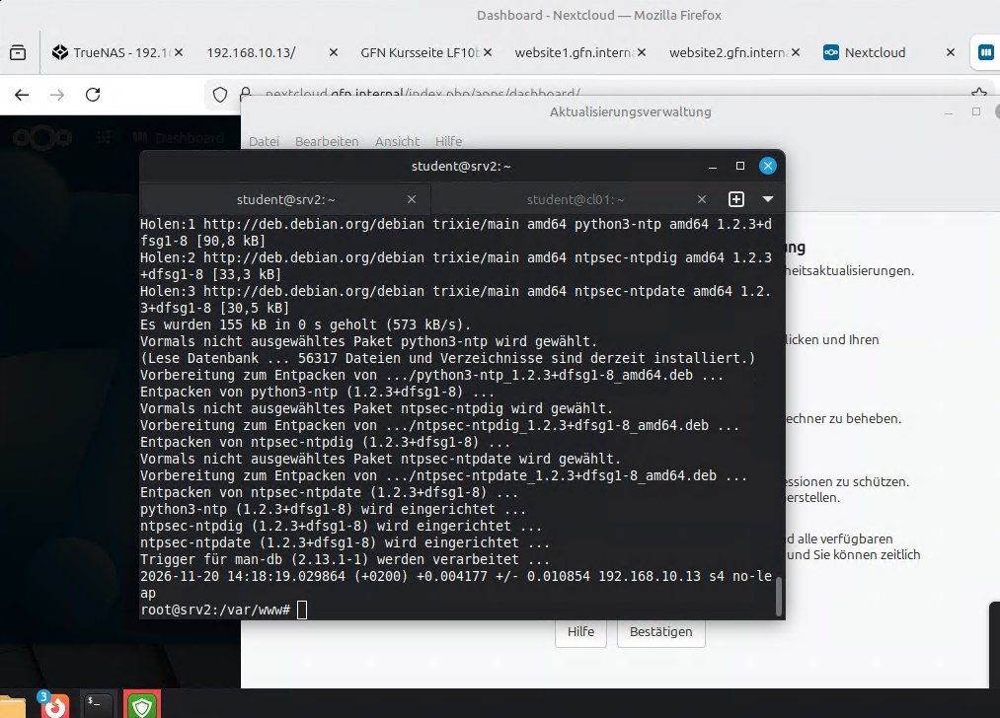

| Portainer über https://192.168.10.13:9443 |
|---|
| 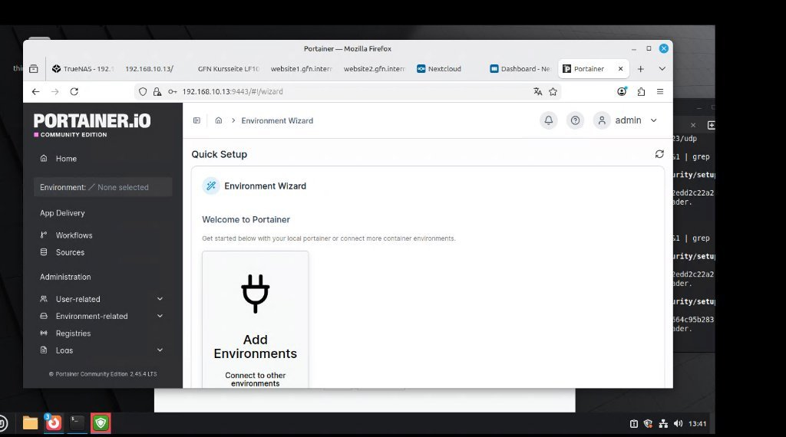 |

## Mailserver und Mailclient

| Proxmox: LXC-Container srv3 | Thunderbird: Testmail admin → student |
|---|---|
| 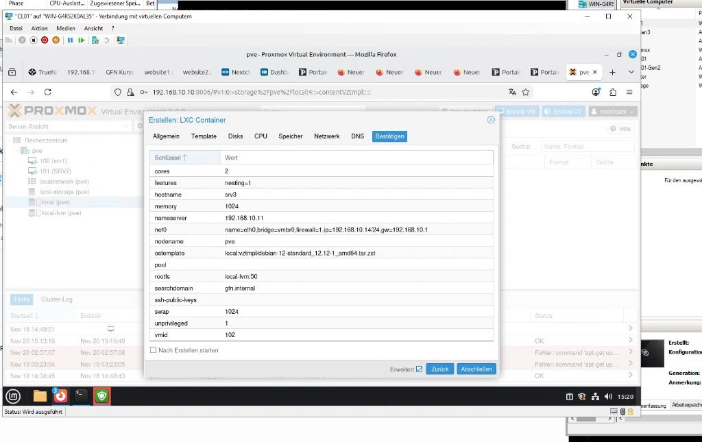 | 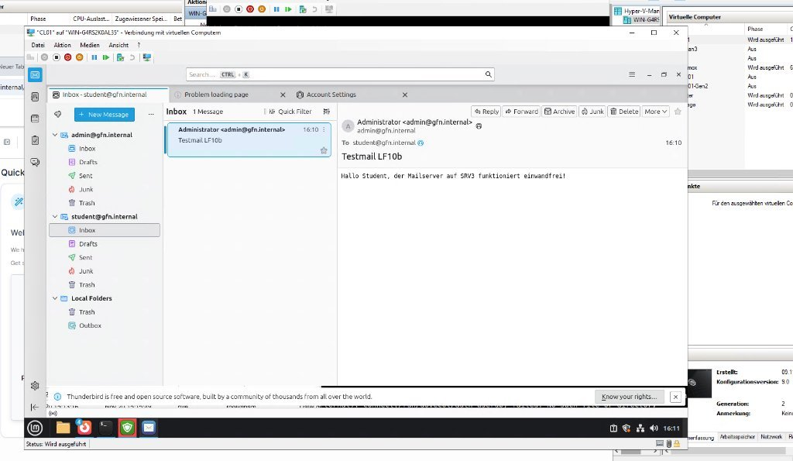 |
